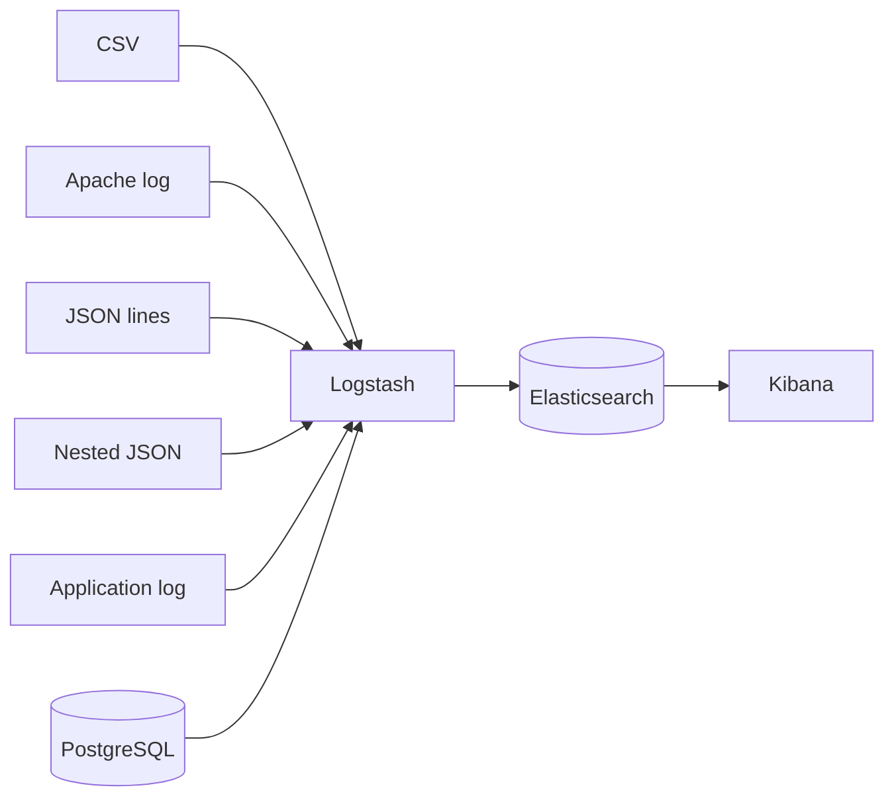

# Logstash examples

Six runnable Logstash pipelines, one Docker Compose stack, and no hardcoded
paths or committed credentials.

[](https://github.com/iamyacin/logstash-examples/actions/workflows/validate.yml)
[](LICENSE)


This is a learning reference for common Logstash ingestion patterns. Each
example is a self-contained pipeline with sample data and a short write-up of
the fields and queries it produces. The stack is intentionally small enough to
run on a laptop.

> **Not production configuration.** Security is disabled and credentials are
> demo defaults. See [Production notes](#production-notes) before reusing any
> of this.

## What's inside

| # | Pipeline | Input | Concepts | Index |
|---|----------|-------|----------|-------|
| [01](examples/01-csv-to-elasticsearch/) | CSV → Elasticsearch | CSV file | `csv`, type conversion, Unix timestamps | `demo-csv-tags` |
| [02](examples/02-apache-log-to-elasticsearch/) | Apache log → Elasticsearch | Combined Log Format | `grok`, `COMBINEDAPACHELOG`, date parsing | `demo-apache-logs` |
| [03](examples/03-json-to-elasticsearch/) | JSON → Elasticsearch | JSON lines | `json`, conditional `drop`, ISO-8601 dates | `demo-json-payments` |
| [04](examples/04-json-arrays-to-elasticsearch/) | Nested JSON → Elasticsearch | JSON with arrays | `split`, field extraction, idempotent writes | `demo-json-array-events` |
| [05](examples/05-grok-patterns/) | Mixed logs → Elasticsearch | App + HTTP logs | multiple grok patterns, `_grokparsefailure` | `demo-grok-patterns` |
| [06](examples/06-postgres-to-elasticsearch/) | PostgreSQL → Elasticsearch | JDBC query | `jdbc`, env-based credentials, primary-key IDs | `demo-postgres-countries` |

## Quick start

Requirements: Docker with Compose v2, about 4 GB of free RAM, and ports
`5601`, `9200` and `5433` available.

```bash
git clone https://github.com/iamyacin/logstash-examples.git
cd logstash-examples

make up                              # Elasticsearch + Kibana + PostgreSQL
make run EXAMPLE=01-csv-to-elasticsearch
make kibana                          # creates the "demo-*" data view
make count                           # document counts per index
```

Open <http://localhost:5601> → **Discover** → select **Logstash demos**.

Examples 01–05 read their file and exit by themselves (`mode => "read"` plus
`exit_after_read => true`). Example 06 is a polling JDBC input; stop it with
**Ctrl+C** after the first rows are indexed.

## Architecture



Everything runs locally:

- **Elasticsearch** on `:9200`
- **Kibana** on `:5601`
- **PostgreSQL** on `:5433` (host), seeded from
  `examples/06-postgres-to-elasticsearch/init/01-country.sql`
- **Logstash** in a one-off container, with the selected example mounted at
  `/example`

## Commands

| Command | What it does |
|---------|--------------|
| `make up` | Start Elasticsearch, Kibana and PostgreSQL |
| `make run EXAMPLE=<name>` | Run one pipeline and index its data |
| `make count` | Print document counts for `demo-*` indices |
| `make kibana` | Create the `demo-*` Kibana data view |
| `make down` | Stop containers, keep the data volumes |
| `make reset` | Stop containers and delete all indexed data |
| `make validate` | Build the image and syntax-check every pipeline |
| `make smoke` | Run examples 01–05 end-to-end and check document counts |

`make help` lists the available examples.

## Configuration

Defaults live in `docker-compose.yml`; override them in a local `.env` file
(see `.env.example`) or in the shell.

| Variable | Default | Purpose |
|----------|---------|---------|
| `ELASTIC_VERSION` | `9.5.5` | Elasticsearch, Kibana and Logstash image tag |
| `EXAMPLE` | `01-csv-to-elasticsearch` | Example directory mounted into Logstash |
| `ES_HOSTS` | `http://elasticsearch:9200` in Compose | Elasticsearch output URL |
| `POSTGRES_PORT` | `5433` | PostgreSQL host port (inside Compose it is always `5432`) |
| `PG_USER` | `logstash` | PostgreSQL user |
| `PG_PASSWORD` | `logstash` | PostgreSQL password |
| `PG_HOST` / `PG_PORT` / `PG_DATABASE` | `postgres` / `5432` / `dvdrental` | JDBC connection |
| `JDBC_DRIVER` | `/usr/share/logstash/drivers/postgresql.jar` | Driver inside the image |

The pipelines also work without Docker if Logstash runs locally: set
`EXAMPLE_DIR` to an example directory and `ES_HOSTS` to your cluster.

## Design notes

- **No hardcoded home directories.** Every input path is
  `${EXAMPLE_DIR:/example}/data/...`.
- **No credentials or binaries in git.** The PostgreSQL driver is downloaded
  in the Logstash image; database credentials come from the environment.
- **Real `@timestamp` values.** Each pipeline applies a `date` filter where
  the source has a timestamp, so Kibana time filtering works.
- **ECS-aware fields.** Pipelines run in Logstash's default ECS mode, and the
  docs use ECS names (`http.response.status_code`, `source.address`, ...)
  rather than the legacy Apache names.
- **Idempotent demos.** File inputs reset their `sincedb`, and the nested JSON
  and JDBC pipelines use deterministic document IDs.
- **Tested configuration.** GitHub Actions builds the image, runs
  `logstash --config.test_and_exit` on every pipeline, then executes examples
  01–05 against a real Elasticsearch and asserts the document counts.

## Testing

```bash
make validate   # syntax-check all six pipelines (no Elasticsearch needed)
make smoke      # delete demo indices, run 01-05, assert document counts
```

`make smoke` is intentionally destructive: it removes the `demo-*` indices
before loading them again, so the counts are deterministic. Example 06 is a
polling JDBC input and is not part of the smoke run.

## Production notes

Before adapting these examples:

1. Enable Elasticsearch security, TLS and authentication. Never expose
   `9200`/`5601` publicly as this Compose file does.
2. Move secrets to the Logstash keystore or your platform's secret manager
   instead of plain environment variables.
3. Replace dynamic mappings with explicit index templates and use ILM for
   retention.
4. Enable the persistent queue and a dead-letter queue so a restart or a bad
   document does not lose data.
5. Use `:sql_last_value` for incremental JDBC loads, and schedule the input
   instead of running it once.
6. Add monitoring, pipeline metrics and alerting.

## Sample data

The sample files are intentionally small (except the Apache log) and exist
only to make the pipelines runnable:

- `tags.csv` is a MovieLens tags sample. MovieLens data is distributed for
  non-commercial use; see the
  [MovieLens dataset page](https://grouplens.org/datasets/movielens/) and the
  Harper & Konstan (2015) paper for attribution.
- `access.log` is a sample web-server log in Combined Log Format.
- The JSON files are synthetic payment/event records.
- The `country` rows are a subset of the classic PostgreSQL `dvdrental`
  sample database.

## License

[MIT](LICENSE) © 2021–2026 Yassine Daouji
